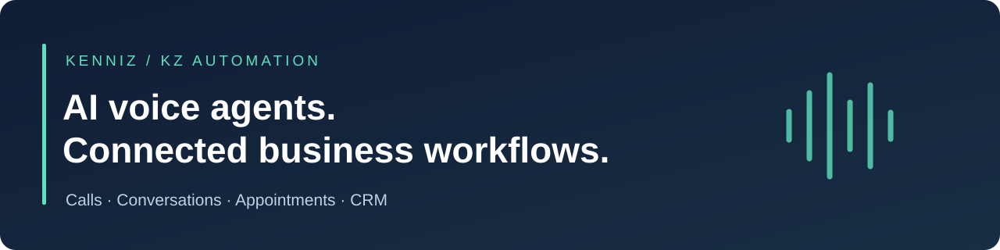

# Kenniz | AI Voice Agent & Automation Developer

**AI receptionists · Outbound calling · n8n & Make.com · GoHighLevel · Chatbots**

I help businesses turn missed calls, slow follow-up, and disconnected tools into a more organized customer experience. My work brings voice agents, messaging, calendars, and CRMs together so customers can get answers and your team can act on the right information.

**[Hire me / discuss your project on Upwork](https://www.upwork.com/freelancers/kenniz)**  
[Selected work](#selected-work) · [Services](SERVICES.md) · [Client feedback & references](CLIENT-REFERENCES.md) · [Delivery process](WORKING-TOGETHER.md) · [FAQ](FAQ.md)

## Professional track record
**Top Rated · 100% Job Success · 180 total jobs on Upwork**

These figures come from an indexed public profile snapshot retrieved on **30 October 2026**; the source had been crawled the previous month and may lag the live profile. Total jobs is not a completed-project count. [Check the current Upwork profile](https://www.upwork.com/freelancers/kenniz). Financial figures are intentionally omitted from this portfolio.

## What I can help your business improve
| If your team is dealing with… | I can help with… |
| --- | --- |
| Calls arriving while staff are busy | AI receptionists with clear escalation and appointment support |
| Leads waiting too long for a first conversation | Outbound calling and follow-up workflows |
| Repeated questions on WhatsApp or your website | Conversational assistants using approved business information |
| Duplicate entry across business tools | CRM, calendar, and automation integrations |
| Prospects dropping out during booking | Availability checks, appointment coordination, and confirmations |
| An existing agent that behaves inconsistently | Review and improvement of conversation and integration behavior |

The goal is practical improvement to your process. Exact features and acceptance criteria are agreed for your business.

## Selected work
| Portfolio | What to look for | Evidence / type |
| --- | --- | --- |
| **[Olivia: outbound calling & appointment booking](https://github.com/kennizautomation/ai-outbound-calling-agent)** | How Vapi, GHL, Make.com, and GHL Calendar support the customer journey | Project case study with eight redacted configuration screenshots |
| **[AI Voice Receptionist](https://github.com/kennizautomation/ai-voice-receptionist)** | Incoming-call experience, appointment assistance, and staff handoff | Detailed solution showcase |
| **[WhatsApp Appointment Automation](portfolio/whatsapp-appointment-automation.md)** | Enquiries, qualification, appointment coordination, and follow-up | Service showcase |
| **[n8n Lead & CRM Automation](portfolio/n8n-lead-routing.md)** | Lead organization, ownership, CRM coordination, and notifications | Service showcase |
| **[Lead Qualification & Prioritization](portfolio/lead-qualification.md)** | Consistent lead assessment and a useful handoff to sales | Concept showcase |
| **[Google Workspace Automation](portfolio/google-workspace-automation.md)** | Spreadsheet and document workflows that reduce administrative work | Service showcase linked to a public Upwork listing |
| **[AI Agent Setup & Integration](portfolio/ai-agent-integration.md)** | Configuring and connecting AI tools around a defined business task | Service showcase linked to a public Upwork listing |

A case study describes supplied project evidence. A service showcase explains the scope I can discuss with a client. A concept illustrates an approach without claiming a deployed client result.

## Featured project: Olivia
An outbound assistant for life-insurance enquiries, supporting qualification, appointment selection, and requested advisor handoff.

**Confirmed platform responsibilities:** GHL handles outbound initiation and call-analysis workflows; Vapi runs the conversation; Make.com supports availability and booking; GHL Calendar holds appointments.

[Read the case study](https://github.com/kennizautomation/ai-outbound-calling-agent) · [View the redacted gallery](https://github.com/kennizautomation/ai-outbound-calling-agent/blob/main/GALLERY.md)

## Technology I work with
| Area | Platforms |
| --- | --- |
| Voice AI | Vapi, Retell AI, Twilio, Telnyx, ElevenLabs |
| Automation | n8n, Make.com, APIs, webhooks |
| CRM & business data | GoHighLevel, HubSpot, Zoho, Airtable, Google Sheets |
| Conversational channels | WhatsApp Cloud API, ManyChat, UChat, website chatbots |
| Scheduling | GHL Calendar, Google Calendar, Cal.com, Calendly |
| AI integrations | OpenAI, Claude, model-supported business workflows |

I select tools around the required behavior, existing accounts, maintainability, and operating costs. A listed tool is not a claim that every case study uses it.

## What an engagement can include
- Discovery and an agreed scope of work.
- Conversation or workflow design tailored to your business.
- Configuration and integration of the selected platforms.
- Validation of the normal customer journey and important failure cases.
- A walkthrough and private handover documentation.
- An agreed support arrangement for the delivered scope.

[See the full delivery process](WORKING-TOGETHER.md).

## Ready to discuss a project?
Send me the business task, your existing tools, and the outcome you want. For voice projects, mention whether calls are inbound or outbound and whether appointments or transfers are involved.

**[Start the conversation on Upwork](https://www.upwork.com/freelancers/kenniz)** · [Use the project brief checklist](PROJECT-BRIEF.md)

## Portfolio & confidentiality
This portfolio explains my work at a client-facing level. It does not include production prompts, source code, automation exports, credentials, or step-by-step implementation recipes. Selected screenshots provide visual context with private details concealed.

[Content notice](COPYRIGHT.md) · Based in Nigeria · Working with clients remotely
